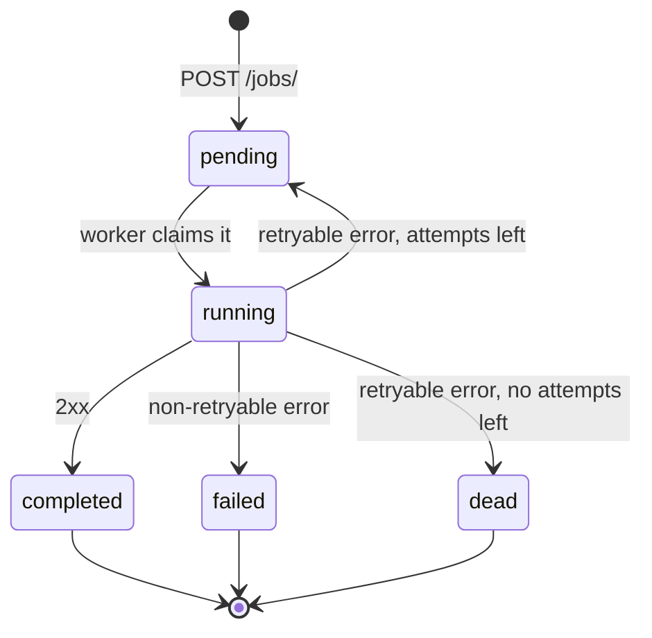

# Retry Scheduler

Accepts jobs (URL + JSON payload), delivers them from a background worker and retries transient failures with exponential backoff. Python 3.12, FastAPI, SQLite, httpx.

## Run locally

```bash
python -m venv .venv
source .venv/bin/activate        # Windows: .venv\Scripts\activate
pip install -r requirements.txt
python -m pytest
```

Each in its own terminal:

```bash
python demo/downstream.py        # fake downstream on :9000: /ok, /bad (400), /down (503), /flaky (503 twice, then 200)
python -m app.api                # http://127.0.0.1:8000/docs
python -m app.worker             # start it twice to see two workers share the jobs
```

```bash
curl -X POST http://127.0.0.1:8000/jobs/ -H "Content-Type: application/json" \
     -d '{"url": "http://127.0.0.1:9000/flaky", "payload": {"order": 42}}'
curl http://127.0.0.1:8000/jobs/<id>/
```

Or with Docker, which starts the API, two workers and the demo downstream. Inside compose the downstream is `http://downstream:9000`:

```bash
docker compose up --build
curl -X POST http://127.0.0.1:8000/jobs/ -H "Content-Type: application/json" \
     -d '{"url": "http://downstream:9000/flaky", "payload": {"order": 42}}'
```

Settings are environment variables (`MAX_ATTEMPTS`, `BACKOFF_BASE_SECONDS`, `DB_PATH`...), see [app/config.py](app/config.py).

## Design

### Lifecycle



- `failed`: the downstream rejected the request (e.g. 400). Retrying won't help.
- `dead`: every attempt hit a transient error. This is the dead letter: the job stays in the table with its `last_error`.
- After a retryable error the job goes back to `pending` with a `next_retry_at`. Workers only claim `pending` jobs that are due.

### Retry timing

Decided by pure functions in [app/retry_policy.py](app/retry_policy.py).

- Retry on 429, 500, 502, 503, 504, timeouts and connection errors. Any other non-2xx answer means `failed`.
- Wait after attempt `n`: `base * 2^(n-1)`, capped at a maximum. `MAX_ATTEMPTS` includes the first attempt.
- No cron: the worker's poll loop picks up a job once its `next_retry_at` has passed.

### No double processing with multiple workers

- Atomic claim: one `UPDATE ... WHERE id = (SELECT ... LIMIT 1) RETURNING *`. SQLite has a single writer, so two workers can't take the same job. On Postgres this would be `FOR UPDATE SKIP LOCKED`.
- Lease: a claimed job gets `locked_until`. If its worker crashes, another worker takes it after that time.
- Fencing: a worker can only save its result if `attempts` hasn't changed since its claim, so a worker whose lease expired can't overwrite a newer result.
- At-least-once: if a worker crashes after the downstream got the request, the job is sent again. Every request carries `Idempotency-Key: <job id>` so the downstream can drop repeats.

### Tests

- `retry_policy`: pure functions, no I/O.
- `repository`: real SQLite, including 4 threads claiming 50 jobs with no duplicates.
- `worker`: real SQLite, a fake downstream with scripted status codes and a fake clock, so retries need no sleeping.
- `api`: FastAPI TestClient, including one job going through POST, the worker and GET.

## Assumptions

- The payload is any JSON value, sent as the POST body.
- 502, 504, timeouts and connection errors are retried too. Redirects are not followed and count as `failed`.
- `GET` also returns `last_error`.
- The API and the workers share one SQLite file, so they run on one machine.

## Trade-offs

- SQLite: no setup, but one machine and serialized writes. Moving to Postgres only changes `repository.py`.
- Polling instead of a message broker: simpler, at the cost of up to 1 s delay and queries while idle.
- No jitter: predictable and easy to test, but jobs that fail together retry together.
- Only the URL scheme is validated. There is no SSRF protection, since the demo itself calls localhost.

## With more time

- Postgres with `SKIP LOCKED`.
- Jitter, and honouring `Retry-After`.
- SSRF protection.
- A history of attempts, and an endpoint to re-queue dead jobs.
- Metrics and a health endpoint.
