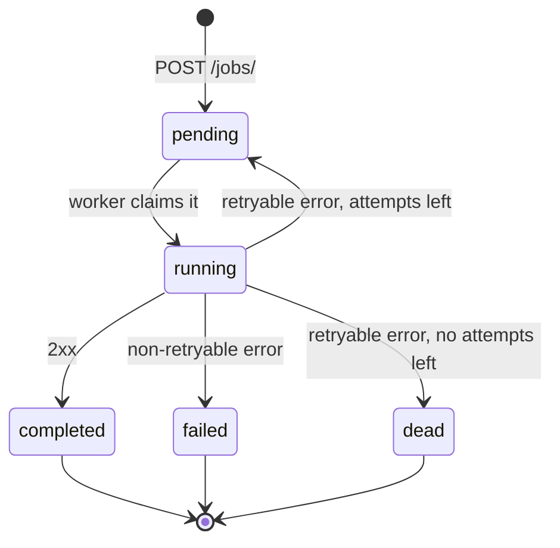

# Retry Scheduler

A small service that accepts jobs (a target URL and a JSON payload), delivers them from a background worker, and retries transient failures with exponential backoff.

## Design

### Job lifecycle

| State | Meaning |
|---|---|
| `pending` | Waiting for its first attempt, or for `next_retry_at` to pass |
| `running` | Claimed by a worker, request in flight |
| `completed` | Final. The downstream answered 2xx |
| `failed` | Final. The downstream rejected the request (e.g. 400, 404), so sending it again won't change the answer |
| `dead` | Final. Every attempt hit a transient error. This is the dead-letter state: the job stays in the database with its attempts so it can be inspected |

`failed` and `dead` are both final but mean different things: `failed` is a problem with the request, `dead` is a downstream that stayed unavailable.

After a retryable error the job goes back to `pending` with a new `next_retry_at`. There is no separate "waiting for retry" state, because a worker only needs to know whether a job is due: it claims a `pending` job only when `next_retry_at` is empty or in the past.

### When to retry

The decision lives in [app/retry_policy.py](app/retry_policy.py) as pure functions. The status code, the attempt number and the current time are passed in, so the tests need no network, no database and no sleeping.

| Result of the attempt | Outcome |
|---|---|
| 2xx | success, the job is `completed` |
| 429, 500, 502, 503, 504, timeout, connection error | retry: back to `pending`, or `dead` when no attempts are left |
| anything else (3xx, 4xx, 501) | permanent, the job is `failed` |

The wait after failed attempt `n` is `base * 2^(n-1)`, capped at `max`. With a base of 10 s and a cap of 60 s that gives 10 s, 20 s, 40 s, 60 s, 60 s...

`max_attempts` counts every attempt including the first, the same number `GET /jobs/{id}/` returns as `attempts`. With `max_attempts = 3` a job is tried once and retried twice before it becomes `dead`.
